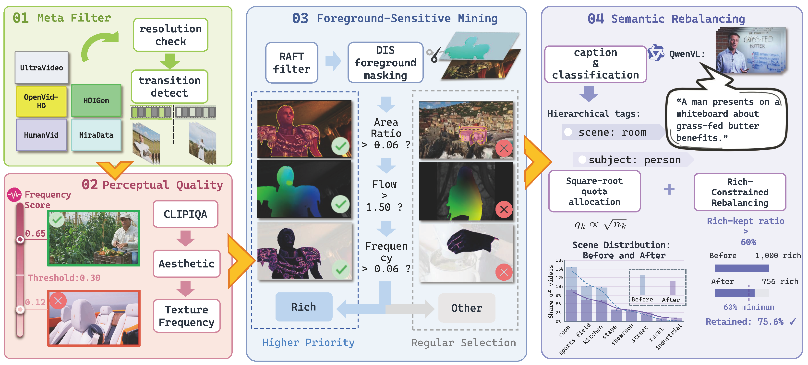
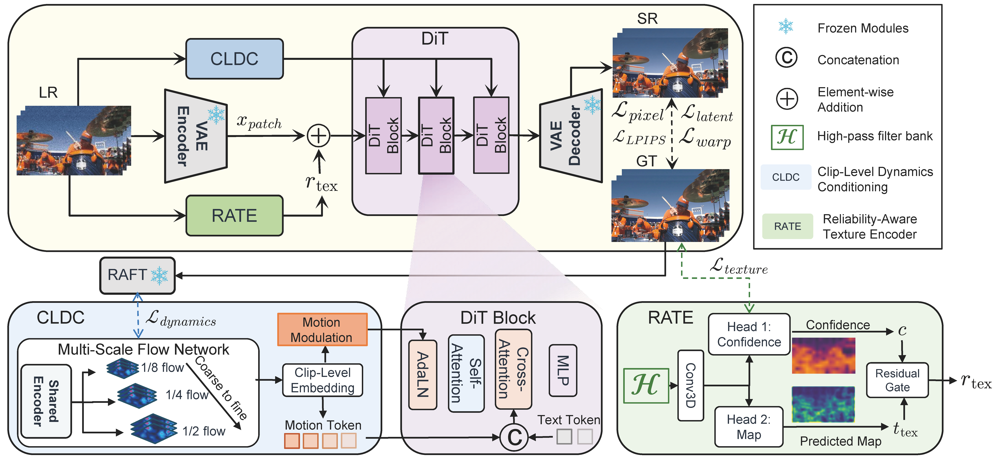
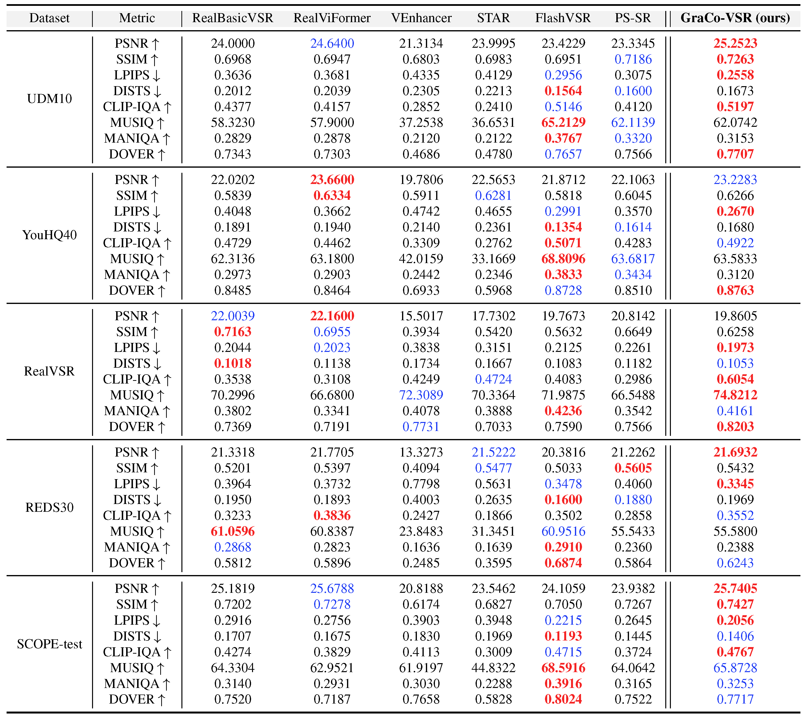
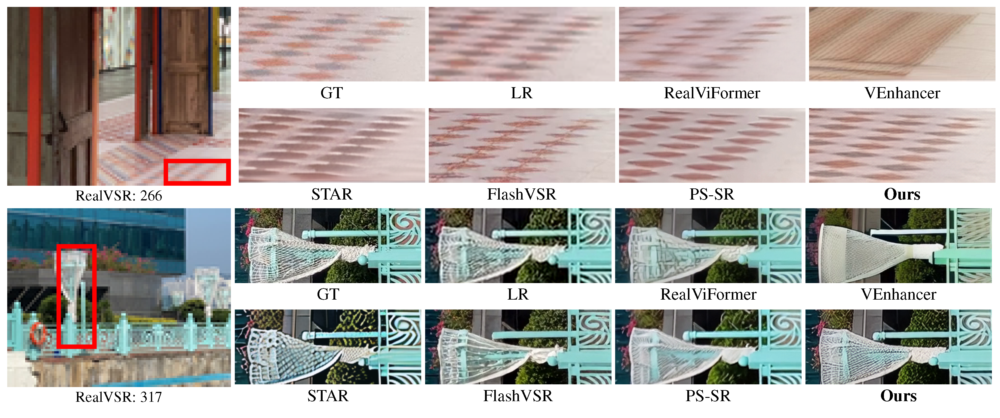
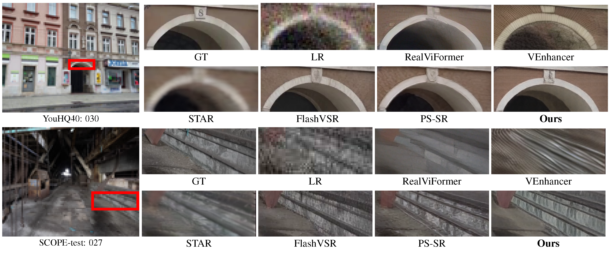
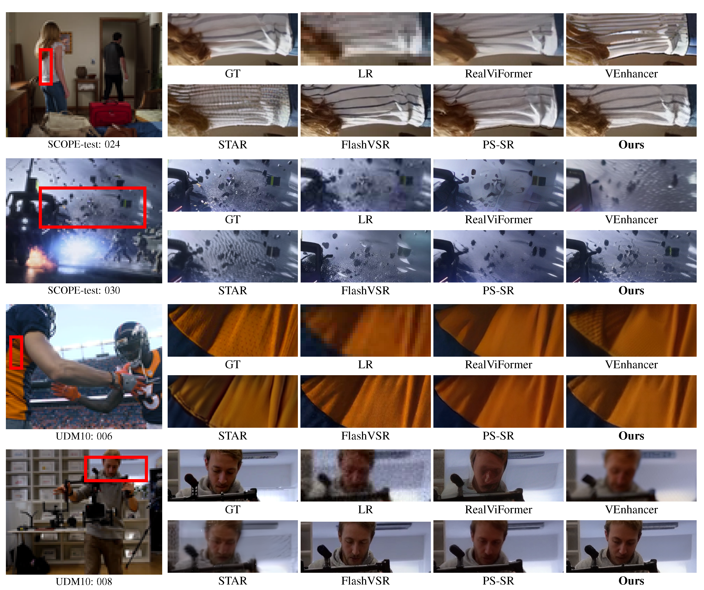
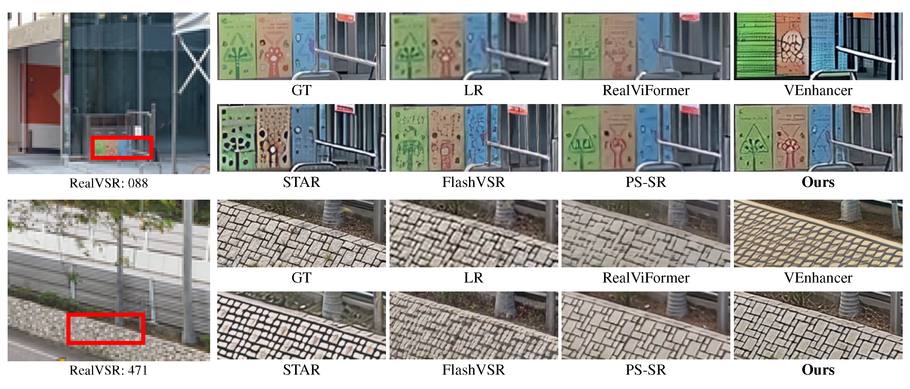

<!--
<div align="center">
<p align="center"></p>
</div>
-->

# Scope-VSR: A Broad-Coverage Training Dataset for Video Super-Resolution

[Gengyu Liao](https://github.com/nunglaanha), [Yechun Yong](), [Zheng Chen](https://zhengchen1999.github.io/), [Jianze Li](), [Ziqing Zhang](), [Linghe Kong](https://www.cs.sjtu.edu.cn/~linghe.kong/), and [Yulun Zhang](https://yulunzhang.com/), "Scope-VSR: A Broad-Coverage Training Dataset for Video Super-Resolution", under review


<!--
<div>
<a href="RELEASE_URL" style="text-decoration: none;"></a>
<a href="VISITOR_BADGE_URL" style="text-decoration: none;"></a>
<a href="STARGAZERS_URL" style="text-decoration: none;"></a>
</div>

[[paper](PAPER_URL)] [[project](PROJECT_URL)] [[arXiv](ARXIV_URL)] [[supplementary material](SUPPLEMENTARY_URL)] [[dataset](DATASET_URL)] [[pretrained models](MODEL_URL)]
-->

#### 🔥 News

- **2026-10-14:** This repository is being prepared for release.

---

> **Abstract:** Diffusion models have shown superior performance in video super-resolution (VSR). However, restoring diverse real-world content remains challenging due to the lack of balanced semantic coverage in existing training data. In this paper, we introduce a structured curation pipeline for open-domain VSR, SCOPE. In this pipeline, we combine task-oriented video selection with hierarchical semantic rebalancing. Applying this pipeline to a large-scale collection of data sources, we construct the SCOPE-VSR dataset for training and SCOPE-test for testing. SCOPE-VSR has approximately 27k videos with a balanced and diverse coverage of various real-world scenarios and subjects. In addition, we propose GraCo-VSR, a novel framework for one-step video restoration. GraCo-VSR adopts a reliability-aware design with explicit supervision to reduce degradation-induced distortions in motion and texture guidance. This design enables the model to better leverage the diverse training content in SCOPE-VSR, thereby supporting generalization across varied scenarios. Experiments demonstrate that our model exhibits strong performance on both perceptual fidelity and visual quality.

<!--


---

<table border="0" style="width: 100%; text-align: center; margin-top: 20px;">
  <tr>
    <td><video src="VIDEO_URL_1" controls autoplay loop></video></td>
    <td><video src="VIDEO_URL_2" controls autoplay loop></video></td>
  </tr>
</table>

---
-->

---

### SCOPE Data Curation Pipeline



---

### GraCo-VSR



## 🔖 TODO

- [ ] Release testing code.
- [ ] Release pretrained models.
- [ ] Release training code.
- [ ] Release SCOPE-VSR.
- [ ] Release SCOPE-test.
- [ ] Release the project page.

<!--
## 🔧 Dependencies

The environment configuration will be provided with the source-code release.


- Python 3.x
- PyTorch
- Diffusers

```bash
git clone REPOSITORY_URL
cd SCOPE-VSR
conda create -n scope-vsr python=PYTHON_VERSION
conda activate scope-vsr
pip install -r requirements.txt
```
-->

## 🔗 Contents

1. [Datasets](#datasets)
2. [Models]
3. [Training]
4. [Testing]
5. [Results](#results)
6. [Citation](#citation)
7. [Acknowledgements](#acknowledgements)

## <a name="datasets"></a>📦 Datasets

<!--
### 🚂 Training Dataset

SCOPE-VSR contains **27,351** high-quality videos curated from five publicly available video collections.

| Dataset | Type | # Videos | Download |
| --- | :---: | ---: | :---: |
| **SCOPE-VSR** | Video | 27,351 | Coming soon |

The source collections include OpenVid-HD, UltraVideo, MiraData, HumanVid, and HOIGen. The release format will follow the licenses and redistribution policies of the original datasets.

All training data should follow this structure:

```shell
datasets/
└── train/
    └── SCOPE-VSR/
```


> **SCOPE-VSR description:**
>
> - Constructed using the proposed SCOPE pipeline.
> - Curated from an initial collection of approximately 0.6 million videos.
> - Designed for broad and balanced coverage of real-world scenarios and subjects.
> - Detailed configurations and statistics are provided in the paper.

### 🧪 Test Datasets

We evaluate the model on synthetic and real-world VSR datasets. Download links and preprocessing instructions will be provided upon release.

| Dataset | Type | # Videos | Download |
| --- | :---: | ---: | :---: |
| UDM10 | Synthetic | 10 | Coming soon |
| YouHQ40 | Synthetic | 40 | Coming soon |
| SCOPE-test | Synthetic | 40 | Coming soon |
| RealVSR | Real-world | 50 | Coming soon |
| REDS30 | Real-world | 30 | Coming soon |

The planned directory structure is as follows:

```shell
datasets/
└── test/
    └── [DatasetName]/
        ├── GT/
        ├── GT-Video/
        ├── LQ/
        └── LQ-Video/
```

## <a name="models"></a>🤖 Models

Pretrained weights for GraCo-VSR will be released here.

| Model Name | Description | Hugging Face | Google Drive | Baidu Disk | Visual Results |
| --- | --- | :---: | :---: | :---: | :---: |
| GraCo-VSR | One-step video restoration model | TODO | TODO | TODO | TODO |

Place downloaded model files in `pretrained_models/GraCo-VSR/`. 

## <a name="training"></a>🚀 Training

Training code and configuration files are being cleaned and validated. Reproducible commands, data preparation instructions, hardware requirements, and checkpoint conventions will be added with the code release.

TODO: Add dataset preparation commands, pretrained model dependencies,
distributed training commands, hardware requirements, and checkpoint conversion.

## <a name="testing"></a>🔍 Testing

Inference and evaluation scripts will be released together with the pretrained model.

```shell
# Demo inference
python inference_script.py \
    --input_dir datasets/demo \
    --model_path pretrained_models/GraCo-VSR \
    --output_path results/GraCo-VSR/demo

# Reproduce paper results
python inference_script.py \
    --input_dir datasets/test/SCOPE-test/LQ-Video \
    --model_path pretrained_models/GraCo-VSR \
    --output_path results/GraCo-VSR/SCOPE-test

# Evaluate quantitative metrics
python eval_metrics.py \
    --gt datasets/test/SCOPE-test/GT \
    --pred results/GraCo-VSR/SCOPE-test \
    --metrics METRIC_LIST
```
-->

## <a name="results"></a>🔎 Results

We evaluate GraCo-VSR on synthetic datasets (UDM10, YouHQ40, and SCOPE-test) and real-world datasets (RealVSR and REDS30). Quantitative and qualitative results will be added after the paper artifacts are released.

<details open>
<summary>Quantitative Results (click to expand)</summary>

- Results in Tab. 1 of the main paper
<p align="center">
  
</p>
</details>

<details open>
<summary>Qualitative Results (click to expand)</summary>

- Results in Fig. 6 of the main paper

<p align="center">
  
</p>

- Results in Fig. 7 of the main paper
<p align="center">
  
</p>

  <details>
  <summary>More Qualitative Results</summary>
  
  - More results on UDM10 and SCOPE-test (Fig. 9 in the appendix)
  <p align="center">
    
  </p>

  - More results on RealVSR (Fig. 10 in the appendix)
  <p align="center">
    
  </p>

  

  </details>

</details>

## <a name="citation"></a>📎 Citation

If you find the code helpful in your research or work, please cite the following paper.

<!-- TODO: Replace this placeholder with the official BibTeX entry after publication. -->

```bibtex
@article{liao2027scopevsr,
  title={Scope-VSR: A Broad-Coverage Training Dataset for Video Super-Resolution},
  author={Liao, Gengyu and Yong, Yechun and Chen, Zheng and Li, Jianze and Zhang, Ziqing and Kong, Linghe and Zhang, Yulun},
  journal={arXiv preprint},
  year={2027}
}
```

## <a name="acknowledgements"></a>💡 Acknowledgements

SCOPE-VSR is curated from OpenVid-HD, UltraVideo, MiraData, HumanVid, and HOIGen. We thank the authors and maintainers of these datasets. Additional acknowledgements for codebases and pretrained models will be added with the implementation release.

<!--
## License

TODO: Add code, model, metadata, and media licenses before public release.
Users must also comply with the licenses and terms of the original source datasets.
-->
